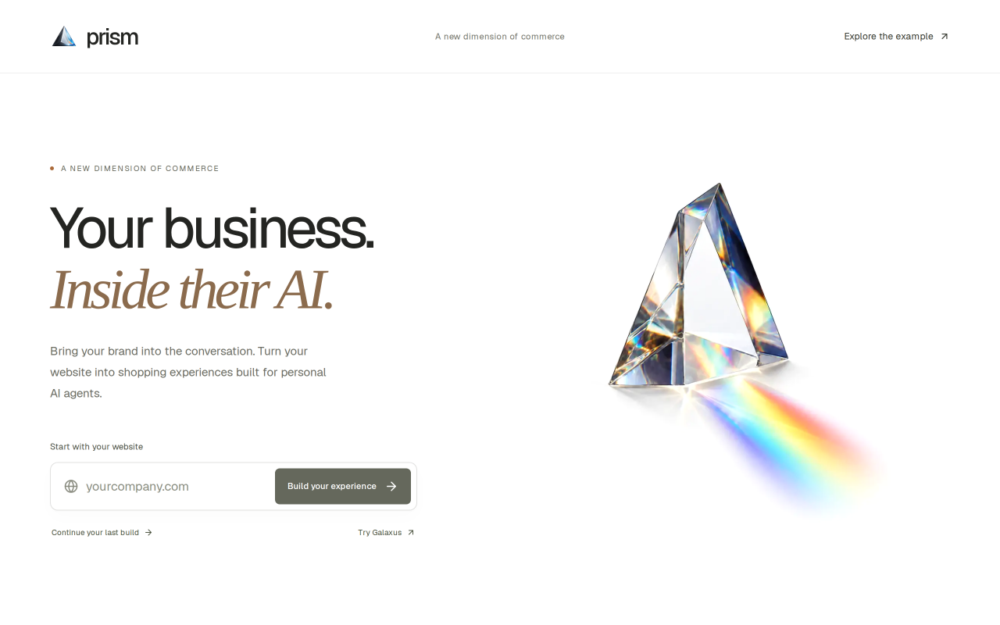
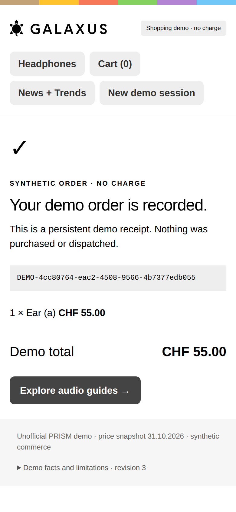
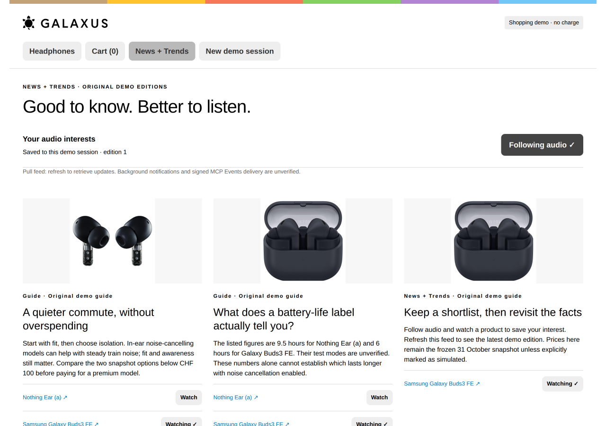

<p align="center"><strong>BASELHACK 2026 · ADOBE CHALLENGE</strong></p>

<h1 align="center">PRISM</h1>

<p align="center"><strong>Your business. Inside their AI.</strong></p>

<p align="center">Turn a business website into a branded experience an agent can discover and act on.</p>

<p align="center">
  <a href="https://prism.mvps.ch">Explore PRISM</a> ·
  <a href="https://galaxus.prism.mvps.ch/widget">Try the retail demo</a> ·
  <a href="#the-challenge">The challenge</a> ·
  <a href="#run-locally">Run locally</a>
</p>



## The challenge

Built for **The Post-Website Business**, Adobe's challenge at **BaselHack 2026**. The brief asks how a local business establishes and controls its presence when its visitor is an AI agent. It calls for both a believable vision and a prototype that demonstrates a real part of it. [Read the archived challenge brief →](docs/challenge-brief.md)

A website gives people pages to browse. An agent also needs explicit facts, available actions and reliable confirmations. If the customer stays inside their assistant, how does a business keep its identity, explain its offering and complete the interaction?

**Our answer is a business-owned experience inside the conversation.** The owner starts with their website, chooses what customers can do, and publishes a branded interface alongside tools the agent can call. The customer can ask in natural language, inspect products visually and act on the same shopping session.

## From website to conversation

1. **Start with a website.** PRISM reads bounded website metadata and prepares a business profile.
2. **Choose the capabilities.** Enable product discovery, purchasing and updates, or hotel room search, demo reservations and guest guidance. The selection controls the available tools.
3. **Build the experience.** A planner, reviewer and revision pass produce a configuration. The local builder generates a merchant view and stylesheet from the retail or hotel template, compiles it in Docker and verifies its MCP endpoint.
4. **Connect the agent.** MCP tools expose the operations; an MCP Apps widget supplies the visual interface. The server owns the commerce state.

The factory and retail output make this concrete. The repository also retains **Presence**, a hospitality prototype that explores owner-approved offers and consent-based follow-up.

| Challenge question | What we demonstrate |
| --- | --- |
| What does a business publish? | A branded widget and an MCP endpoint with explicit capabilities. |
| How does the owner stay in control? | Capability selection in PRISM; reviewed facts and exact-offer approval in Presence. |
| Can an agent do something useful? | Product filtering, cart changes and a persisted synthetic order; fictional hotel reservations in Presence. |
| Can humans and agents share one presence? | The retail browser preview and agent tools use the same commerce functions. |
| What happens after the transaction? | A pull-based retail updates feed; a separate consent and callback workflow in Presence. |

## A working retail slice

The Galaxus example follows a simple request:

> Find wireless, in-ear, noise-cancelling earbuds for studying. Keep the budget under CHF 100.

The frozen catalogue returns **Nothing Ear (a), CHF 55.00**, and **Samsung Galaxy Buds3 FE, CHF 91.90**. The customer can change filters, compare products, add an item to the cart and record a synthetic order. Model calls and button clicks operate on server-owned state, with revisions and idempotent checkout operations.

<table>
  <tr>
    <td width="74%" valign="top">
      
      <p><sub>Product discovery with explicit filters and frozen catalogue prices.</sub></p>
    </td>
    <td width="26%" valign="top">
      
      <p><sub>A persistent demo receipt. No payment or dispatch.</sub></p>
    </td>
  </tr>
</table>

<details>
<summary>See the retail updates feed</summary>



The feed remembers interests and watched products. Refresh retrieves updates; it does not wake an assistant in the background.

</details>

Screenshots show the actual PRISM landing page and Galaxus browser preview. They are not screenshots of a native ChatGPT session. [Capture notes →](assets/screenshots/README.md)

## The vision

In five to ten years, a business could maintain one approved description of what it offers and what it can promise. Personal agents could query that presence, show the business's own interface when useful, and carry out actions within the customer's permission.

PRISM explores the publishing side of that future. Presence explores the human decisions behind a transaction: ask an owner, approve exact terms, reserve capacity and reconnect only with consent. Together they test how a business can retain a direct relationship when the conversation starts elsewhere.

Automatic discovery across assistant platforms, production identity, live merchant inventory and real payments remain future work.

## What's in this repository

These are **three separate applications**, with independent dependencies and environment configuration.

| Application | Location | Purpose |
| --- | --- | --- |
| PRISM factory | [`prism-factory/`](prism-factory/README.md) | Website intake, capability selection, configured outputs and the new local source builder. |
| Galaxus retail demo | [`galaxus-demo/`](galaxus-demo/README.md) | Standalone MCP Apps storefront with a frozen catalogue and synthetic commerce. |
| Presence | Repository root | Hospitality publishing, owner-approved offers, fictional reservations and consent-based follow-up. [Full guide →](docs/presence-guide.md) |

**Stack:** TypeScript, Next.js, React, MCP / MCP Apps, Postgres / Neon, the Codex SDK and Vercel AI SDK. Presence also uses Resend for its email workflow. The model interprets and plans; application code validates and applies commerce operations.

## Run locally

For the PRISM factory, use **Node.js 24+, pnpm, Docker and a host authenticated with Codex**. Configure `DATABASE_URL` in `prism-factory/.env.local`. Preview chat also needs Vercel AI Gateway authentication. Credentials and native login stores are not included.

```bash
cd prism-factory
pnpm install --frozen-lockfile
pnpm db:migrate
pnpm dev --port 3040
```

In another terminal, from the same folder:

```bash
pnpm worker
```

Open **http://localhost:3040**. The worker handles queued jobs; the web server handles the interface. The new builder uses Docker for generated-app compilation and local execution.

For the standalone storefront, follow the [Galaxus setup](galaxus-demo/README.md). For hospitality, follow the [Presence setup](docs/presence-guide.md). Installing dependencies at the repository root installs Presence, not the PRISM factory.

## Evidence and current limits

- **Validation:** 19 factory tests, TypeScript, lint and production build passed. The Krafft source output passed seven domain/store/render tests, an isolated production build and actual MCP acceptance checks.
- **Source builder:** the full Krafft URL → recommendation → planning/review → generated source → Docker build → running app path was verified. Local sessions survived a real output-container restart.
- **Hotel data:** Krafft Basel uses its official logo, room categories and photographs. Rates, capacities, availability and reservations are simulated. Room/date/guest filtering, quotes, retry-safe demo reservations, latest receipts and guest interests are implemented. The public MCP runtime uses Neon; the independently generated source app remains local with its own file sessions.
- **Retail data:** captured product images and prices from 31 October 2026. Availability, orders and payment are simulated. Other retailer brands currently reuse this prepared demo catalogue. Public Galaxus regression checks passed.
- **Host support:** connection packages cover ChatGPT, Claude, Perplexity, Mistral, Cursor, VS Code Copilot, Goose and restricted-preview Gemini. Perplexity/Mistral are tools-only; Cursor/VS Code/Goose are developer/desktop channels. Grok remains visual-only. Actual provider-account installation/rendering remains unverified; a controlled MCP Apps bridge passed a 390px hotel checkout. [Capabilities and official sources →](docs/prism-platforms.md)
- **Follow-up:** retail uses a pull feed. Presence's separate consent and callback workflow does not establish proactive delivery into third-party assistant hosts.

Try the hotel with `https://www.krafftbasel.ch/en/` in PRISM. [Open the built Krafft browser example](https://prism.mvps.ch/apps/62d9b46320cf841b120e5f35fea685a9694486df/widget).

The Galaxus and hotel examples are independent demonstrations, with no claimed affiliation. No real purchase or accommodation booking is made. Secrets, generated job directories and private verification captures are excluded; only selected screenshots are published here.

## Further reading

[Challenge brief](docs/challenge-brief.md) · [Presence architecture](docs/architecture.md) · [Research sources](docs/sources.md) · [Original concept and pitch](output/pdf/presence-hackathon-plan.pdf)

## License

[MIT](LICENSE) for original code and documentation. Third-party brands, product images and linked materials retain their respective ownership.
