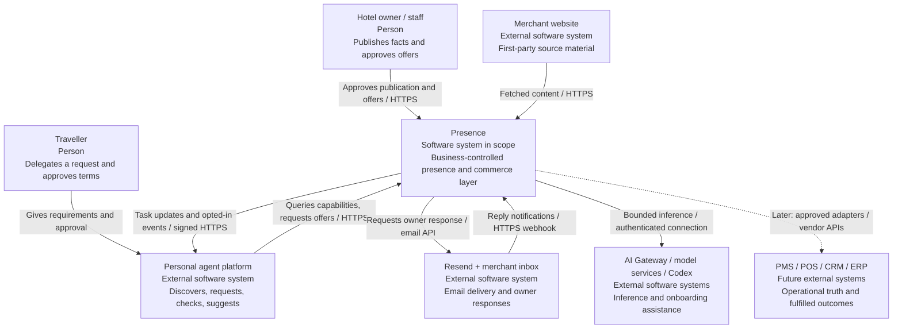
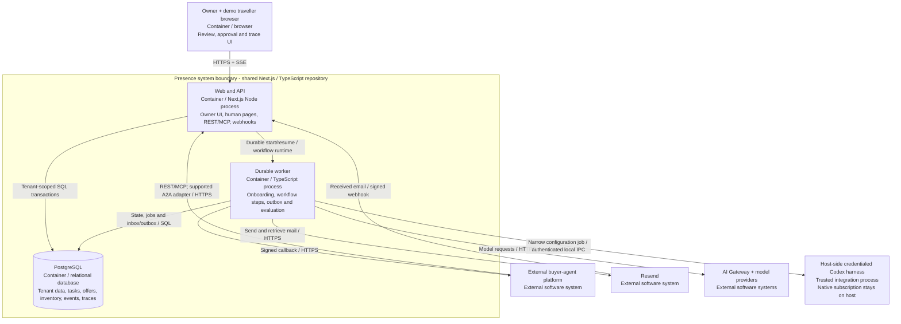
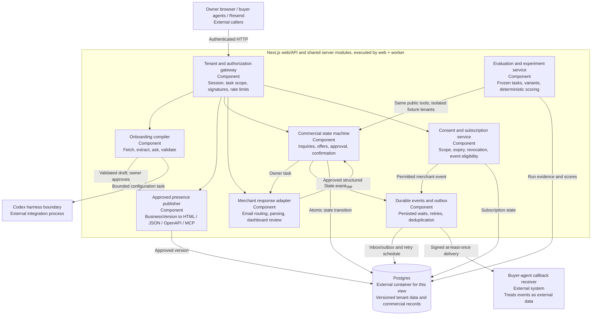

# Presence - proposed C4 architecture

Planning only, 31 October 2026. The system is one shared application. C4 containers describe deployable processes and stores, not separate product codebases. External systems and roadmap integrations are explicit. Mermaid flowcharts are used to render the C4 concepts without a remote diagram service.

## C4 Level 1 - system context



The owner retains commercial authority. The traveller's agent is independently operated. A callback reaches a supported receiver; there is no assumed universal consumer-agent inbox.

## C4 Level 2 - containers



Compose includes web, worker and Postgres; optional Mailpit and a restricted HTTPS tunnel assist demos. The worker uses the same server modules and image, not another backend framework. The workflow World and any additional runtime service are selected and verified in M3. The host harness boundary can be implemented through a supported broker/bridge; do not assume credentials automatically appear inside Docker. The demo traveller's model loop can run in the worker; an external agent is shown to clarify the future integration boundary.

## C4 Level 3 - application components



Commercial mutation is deterministic. LLM proposals do not bypass authorization or state checks. C4 Level 4 is deferred until implementation.

## Dynamic view - asynchronous booking

```mermaid
sequenceDiagram
  actor Traveller
  participant Buyer as Buyer agent
  participant API as Presence API
  participant DB as Postgres
  participant Worker as Durable worker
  participant Mail as Resend
  actor Owner
  Buyer->>API: Create inquiry with idempotency key
  API->>DB: Save inquiry + owner-email outbox atomically
  API-->>Buyer: 202 task ID and status URL
  Worker->>DB: Claim persisted email job
  Worker->>Mail: Send requirements and scoped response link
  Mail-->>Owner: Owner email
  Owner->>Mail: Reply with proposed offer
  Mail->>API: Signed received-email webhook
  API->>DB: Deduplicate, correlate and persist incoming event
  API-->>Mail: Acknowledge after persistence
  Worker->>Mail: Fetch complete received email
  Worker->>DB: Store parsed draft; request owner review
  Owner->>API: Authenticate and approve offer version
  API->>DB: Save immutable offer + callback outbox
  Worker-->>Buyer: Signed task-updated event
  Buyer->>API: Read current task and offer
  Buyer->>Traveller: Request approval of CHF 205 and exact terms
  Traveller-->>Buyer: Approve this offer version
  Buyer->>API: Accept offer with idempotency key
  API->>DB: Validate version, authority, expiry; commit fictional inventory
  API-->>Buyer: Confirmed fictional reservation and receipt
  Note over API,Owner: Real email-only merchant: acceptance stays pending until owner confirms in system of record
```
