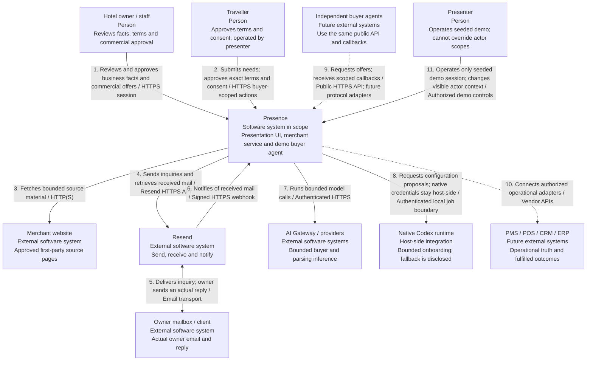
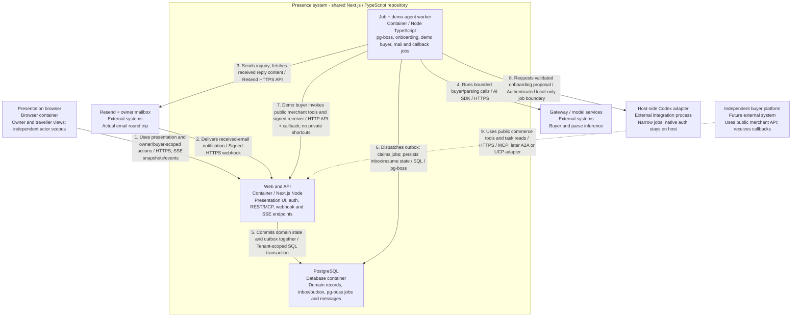
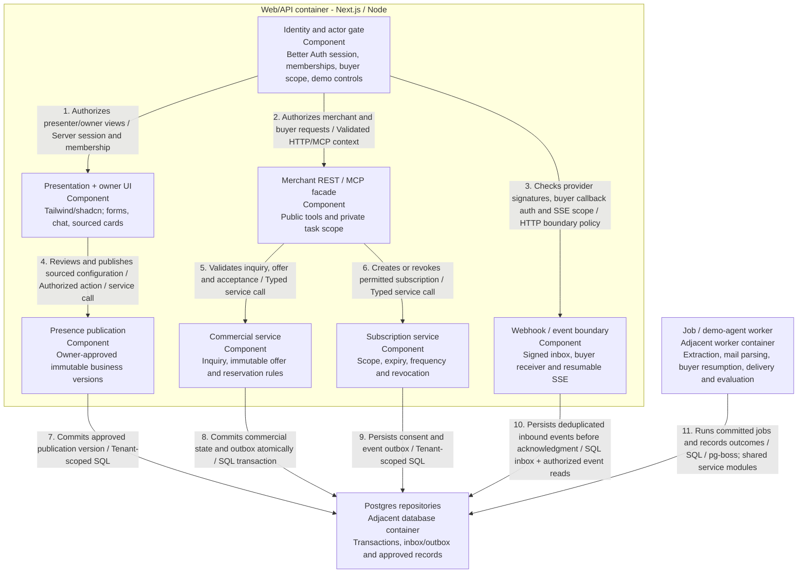
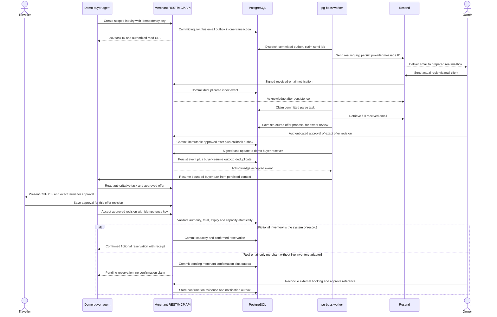

# Presence - reviewed C4 architecture

Version 2 | 31 October 2026 | Proposed architecture, not a deployed system.

The running demo is one shared Next.js/TypeScript application, with its own buyer-agent simulator. The presenter operates the owner and traveller views; each action still has an authorized domain actor. Independent consumer-assistant platforms and PMS/POS/CRM/ERP adapters are future integrations.

`architecture.json` is the canonical node/relationship data, including native-vector PDF layout. Run `python docs/render_architecture.py` to regenerate the Mermaid blocks. `render_plan.py` reads the same data. Change the graph once rather than maintaining separate Mermaid and PDF models.

<!-- BEGIN GENERATED C4 -->

## C4 Level 1 - system context

The running prototype includes its demo buyer. Future platforms are outside the boundary.




## C4 Level 2 - containers

One Next.js/TypeScript repository; pg-boss worker and database persist human waits.




## C4 Level 3 - web/API components

This view decomposes the web/API container only. Worker execution is outside it.



<!-- END GENERATED C4 -->

## Container responsibilities

- **Web/API:** presentation and owner UI, Better Auth boundary, owner membership/buyer scopes, public REST/MCP, provider/buyer webhook inbox and authorized SSE reads. Database mutations and their outbox records commit together.
- **Worker:** pg-boss jobs, bounded onboarding, mail send/parse, the demo buyer model loop, signed callback delivery, resume scheduling, consent-aware event delivery and evaluations. It invokes the merchant HTTP API as the buyer and uses shared services only for its authorized worker responsibilities.
- **Postgres:** commercial truth, approved versions, messages, authorization records, inbox/outbox, queue jobs and delivery attempts. A dispatcher schedules jobs from committed outbox rows. Replaying a queue job does not replay an already-applied domain effect.
- **Host-side Codex adapter:** private integration for typed configuration proposals, with native credentials outside Compose and tenant workspaces. Gateway extraction is a disclosed fallback. Neither is a public shell execution endpoint.

Level 3 decomposes the web/API container. Its adjacent worker contains separate extraction, mail, buyer, delivery and evaluation handlers; the evaluation handler is not a consent service. Level 4 is deferred; module ownership and invariants are specified in [implementation-spec.md](implementation-spec.md).

## Dynamic view - booking through real email



## Dynamic view - consented follow-up

```mermaid
sequenceDiagram
  actor Traveller
  actor Owner
  participant API as Presence API
  participant DB as PostgreSQL
  participant Worker as Dispatcher and jobs
  participant Receiver as Demo buyer receiver
  participant Buyer as Buyer agent
  Traveller->>API: Explicit scoped subscription
  API->>DB: Store consent, expiry and frequency cap
  Owner->>API: Publish relevant fictional event
  API->>DB: Commit immutable event and outbox
  Worker->>DB: Claim delivery and recheck current consent
  alt Still subscribed and event permitted
    Worker->>Receiver: Signed event with unique ID and timestamp
    Receiver->>DB: Commit deduplicated inbox plus resume outbox
    Receiver-->>Worker: Acknowledge after persistence
    Worker->>Buyer: Run bounded relevance check
    Buyer->>DB: Persist suggestion or suppression decision
    API-->>Traveller: Authorized UI event and current suggestion
  else Revoked, expired or frequency-limited
    Worker->>DB: Store suppressed delivery reason
  end
  Traveller->>API: Revoke subscription
  API->>DB: Disable future delivery; record revocation
```

Callbacks are at-least-once, signed and idempotent. They target registered destinations; user-supplied URLs do not grant egress. A notification is external data and never grants purchase authority. A browser SSE stream is a view of persisted state, not the durable agent runtime.
