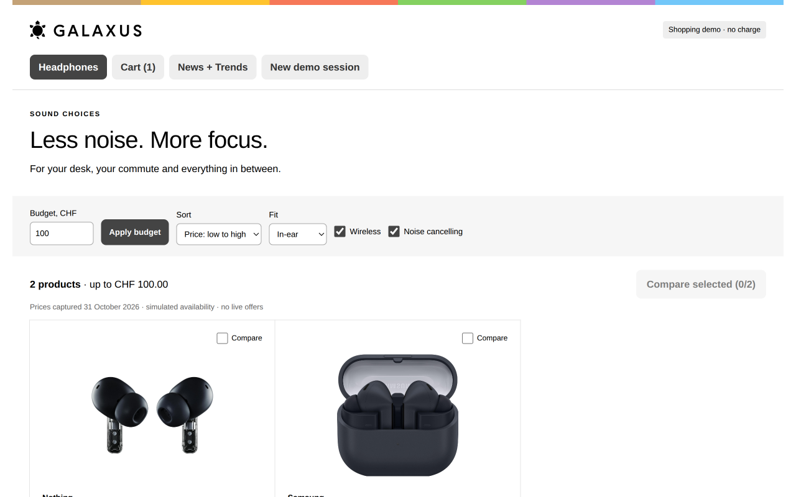

# Galaxus retail demo

**Product discovery, cart and synthetic checkout through MCP Apps.**

[Browser preview](https://galaxus.prism.mvps.ch/widget) · [Connection page](https://galaxus.prism.mvps.ch) · [MCP endpoint](https://galaxus.prism.mvps.ch/mcp) · [Project story](../README.md)



An independent PRISM retail demonstration. Ask an agent to find earbuds, refine filters, update a cart and record a demo order. The widget and model-facing tools use the same deterministic shopping functions and persistent sessions.

## Try the flow

1. Search for wireless, in-ear, noise-cancelling earbuds.
2. Set the budget to CHF 100. The frozen catalogue contains Nothing Ear (a) at CHF 55.00 and Samsung Galaxy Buds3 FE at CHF 91.90.
3. Add Nothing Ear (a). Retrieve the cart through the agent and compare the item, quantity and total with the widget.
4. Review the total and record a synthetic order. Repeating the same checkout operation must not create another order.
5. Follow audio updates and refresh the feed.

The browser preview is useful for testing the storefront. Rendering inside ChatGPT or another native host requires a separate connection and verification.

## Run locally

Requires Node.js and pnpm. Set `DATABASE_URL` in an ignored `.env.local` for the Neon-backed database. There is no ephemeral database fallback.

```bash
pnpm install --frozen-lockfile
pnpm db:migrate
pnpm dev
```

Open **http://localhost:3000/widget**. The migration creates the dedicated demo tables and persists the frozen catalogue and editions.

```bash
pnpm test
pnpm lint
pnpm build
```

To check a deployed endpoint with the maintained MCP SDK:

```bash
TEST_ORIGIN=https://galaxus.prism.mvps.ch node scripts/verify-production.mjs
```

That check creates synthetic sessions and orders. The 10 existing tests passed for the v1 source snapshot; they do not prove every native host interaction works.

## How it works

- `lib/shopping.ts` owns deterministic commerce rules. Prices use integer CHF cents.
- `lib/db.ts` persists sessions with atomic compare-and-swap. Revisions reject stale writes; operation IDs make checkout repeat-safe.
- The 12 MCP tools and widget share the same server-owned state. Browser storage remembers a session capability, not the authoritative cart.
- The standalone widget uses the official MCP Apps bridge. The browser preview uses an MCP client against `/mcp`.

A search issues a random 256-bit session capability. Reuse it across turns; anyone holding it can access that synthetic session. This is demo access control, not OAuth or production customer identity.

## Scope

Product images and prices are captured catalogue data. Stock is simulated per session. No Galaxus login, live inventory, payment processing or real order API is connected. No product is purchased or dispatched. Updates require a pull; they do not wake an assistant in the background.

Built from `vercel-labs/mcp-apps-nextjs-starter` commit `adca42ccaeda3c34a322808b51f70200f14e3c89`. Brand names and product images belong to their owners. This project is not affiliated with Galaxus.
